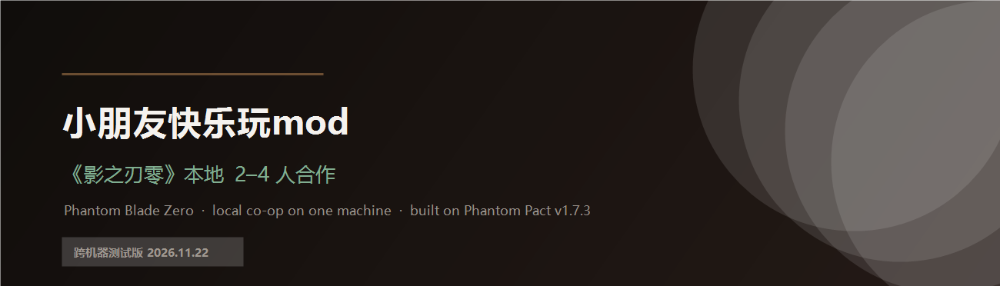

  

# 小朋友快乐玩mod

《影之刃零》**同一台电脑、本地 2–4 人、多显示器合作**。支持全手柄或 1 号键鼠＋队友手柄，基于 [PhantomPact v1.7.3](https://github.com/yhsharaf/PhantomPact)。

## 下载当前版本

### [下载完整安装包 · 2026.11.25 清理测试版](https://github.com/Jenny-tuiling/PhantomPact/releases/download/cn-2026.11.25-clean/PBZ-KidsCoop-4P-2026.11.25-clean.zip)

[版本说明与附件](https://github.com/Jenny-tuiling/PhantomPact/releases/tag/cn-2026.11.25-clean) · [安装步骤](#安装与开始游玩) · [给 AI 助手的安装说明](docs/INSTALL-FOR-AGENTS.md) · [English](#english)

**下载无需 GitHub 账号。完整解压 → 双击 Install.cmd → 选择游戏目录 → 桌面快捷方式启动。无需 GPT、Python 或开发工具。**

请下载上面的安装包。GitHub 的 **Code → Download ZIP** 和 Release 自动生成的 **Source code** 是仓库源码，不是完整安装包。

## 安装与开始游玩

1. 在 Windows 上从 Steam 正常安装并启动过《影之刃零》。本版只支持 **Steam build 26367565**；安装器会校验游戏版本，不匹配会停止。
2. 备份自己的 `ProjectPBZ/Saved/SaveGames`，保存并退出游戏及设备设置页。已安装其它多人版本时，先按原包方式卸载，不要直接混装。
3. 将 `PBZ-KidsCoop-4P-2026.11.25-clean.zip` **完整解压到普通文件夹**，不要在压缩软件内运行。
4. 双击 `Install.cmd`，选择包含 `platform` 和 `ProjectPBZ` 的 **PBZ 游戏根目录**。Steam → 游戏属性 → 已安装文件 → 浏览，可以找到这个位置。
5. 安装成功后，桌面会创建 **小朋友快乐玩mod - 多人设备设置** 快捷方式。下载 ZIP 本身不会创建快捷方式。
6. 显示器在 Windows 中设为扩展显示。打开快捷方式，开启多人模式，选择 **2 / 3 / 4 人**及键鼠／手柄组合；不开启多人则保持单人。
7. 按设置页提示，各玩家依次按自己手柄 **A** 加入。已绑定设备不必每次重绑，断线重连保持玩家分配；更换设备使用对应玩家的“更换手柄”。摇杆偏移时点卡片顶部 **归中校准**，松开两根摇杆约 4 秒。
8. 选择皮肤、完成设备检查，再点击启动并进入自己的存档。

## 包含什么

- **完整安装包**：设置程序、运行模块、既有补丁、安装／卸载器和中文指导，不必另找旧补丁。
- **独立输入与校准**：键鼠＋手柄、全手柄、A 键认领、常驻归中校准、断线重连保留分配。
- **队友 AI**：2、3、4 号独立开关及状态显示；主动关闭或重启游戏才清除托管意愿，死亡／传送等中断后继续。
- **合作工具**：队友归队、主机召回、操作锁定、安全脱困、视角恢复，以及全员临时无敌＋10 倍伤害开关。
- **五种外观**：魂主角、辰辰、小宝、猪八戒、枫枫；自定义皮肤保留哑光和拒绝场景贴花处理。
- **可切换底座**：默认本地测试底座，以及 **1.7.3＋既有补丁**；退出游戏后在设置页切换。

本包不含游戏本体、个人存档、手柄绑定或校准数据。临时增强默认关闭，接收电脑需设置自己的设备。

## 常用手柄操作

L3／R3＝按下左／右摇杆，LT／RT＝左／右扳机。长按触发后松开，再按才能再次触发。

| 玩家 | 操作 | 组合键 |
|---|---|---|
| 2、3、4 号各自 | 开启／关闭 AI 托管 | L3＋RT 按住 4 秒 |
| 1 号 | 锁定／解锁队友操作 | L3＋RT 按住 3 秒 |
| 1 号 | 召回全部队友 | R3＋LT 按住 3 秒 |
| 1 号 | 安全脱困 | L3＋R3 按住 3 秒 |
| 2、3、4 号各自 | 回到 1 号身边 | L3＋R3 按住 3 秒 |

键鼠快捷键及恢复视角说明见设置页的按键说明和游戏工具。

## 版本范围与已知问题

**当前为 2026.11.25 清理测试版（回退基线）。** 它保留之前的合作补丁，未包含已撤回的“队友复活输入修正”实验补丁。

- 队友复活可能打断 1 号当前动作，仍未修复。
- 多人穿行地图仍有光标／选点问题；庞镇切图尚未实测通过。
- 同时喝药归属、缺席路由、安全复活落点及复杂交互仍有待验证风险。
- 猪八戒、枫枫尚未完成全部动作和场景验收。AI 已在制作机测试，其它机器仍需验证。

已完成设置页 183 项检查、隔离安装／卸载 8 项检查、双底座切换检查及 104 个 Lua 编译检查；打包核对 649 项安装载荷哈希与 ZIP 完整性。这些结果不等于全地图通关或所有电脑稳定性保证。详见包内测试方法与已知问题。

## 文件校验

| 项目 | 值 |
|---|---|
| 文件 | `PBZ-KidsCoop-4P-2026.11.25-clean.zip` |
| 大小 | **20,410,963 字节**（约 19.47 MiB） |
| SHA256 | `587042642b5105d97f7a20b1a69b67c4a011311ebce414cbda5220dce13c2700` |

[下载 SHA256 校验文件](https://github.com/Jenny-tuiling/PhantomPact/releases/download/cn-2026.11.25-clean/PBZ-KidsCoop-4P-2026.11.25-clean.sha256)。解压目录名为“小朋友快乐玩mod-2026.11.25-清理测试版”。

## 卸载与排障

退出游戏和设置页，运行同一完整解压目录内的 `Uninstall.cmd`，选择同一游戏根目录。切换过底座时先切回安装时的本地底座。卸载器遇到安装后修改的文件会停止，保留当前文件和游戏根目录 `FourPlayerBackups` 备份再核对；不要强行删除备份或游戏存档。

报告问题时提供：游戏 build、所选底座、人数、输入组合、复现步骤和相关错误日志。不要公开个人存档或账号信息。

## 源码与来源

**当前成品的对应源码、安装清单和验证记录均在上方完整安装附件中。** 仓库分支保留开发历史，不能把分支源码 ZIP 当成本版完整安装镜像。基础版本固定为 PhantomPact **v1.7.3**，请勿混入其它版本的 DLL 或脚本。

PhantomPact 基础来自 [yhsharaf/PhantomPact](https://github.com/yhsharaf/PhantomPact)；运行依赖包括 UE4SS 及适用组件。实际来源、原始说明及适用许可见安装包内“组件来源.txt”“原作者说明”和组件目录。现有来源声明保留，不给整个组合包附加虚构统一许可。

这是玩家制作的非官方扩展，与 S-GAME 及上游作者无隶属或背书关系。

## English

Local **2–4 player co-op on one Windows PC**, with multiple monitors and controllers, based on PhantomPact **v1.7.3**. This release focuses on local play; it is not a cross-PC multiplayer installer.

[Download the complete 2026.11.25 installer ZIP](https://github.com/Jenny-tuiling/PhantomPact/releases/download/cn-2026.11.25-clean/PBZ-KidsCoop-4P-2026.11.25-clean.zip). Extract everything, close the game and setup app, then run `Install.cmd` and select the PBZ root directory. A desktop setup shortcut is created after successful installation. Requires Steam build **26367565**; no GPT or developer tools needed.

Includes five appearances: Soul, Chenchen, Xiaobao, Zhu Bajie and Fengfeng. The withdrawn experimental revive-input patch is excluded. Teammate revival can still interrupt player 1; travel-map cursor and some progression paths remain known risks. See the bundled installation guide, source and testing notes.
